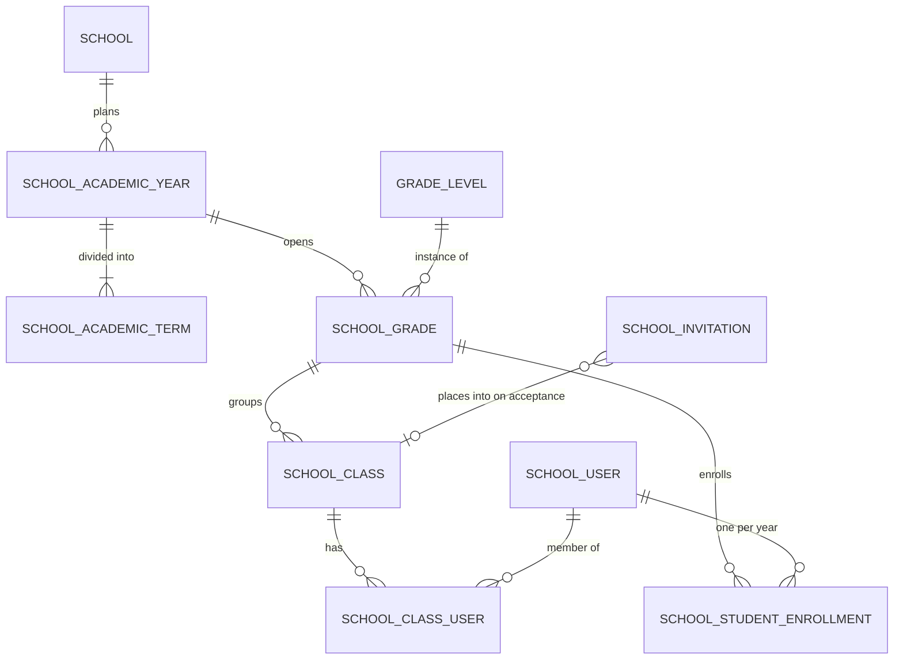
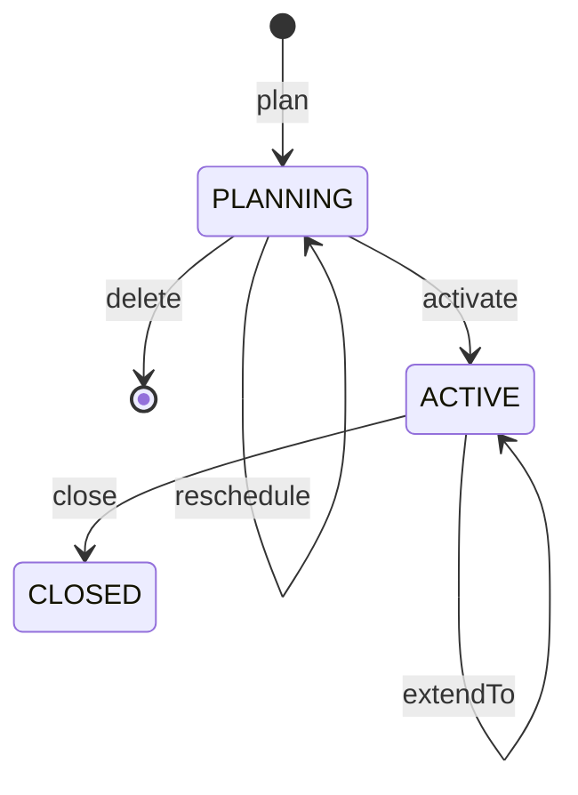

# School Management Flows: Review and Proposals

- **Status:** discussion notes, not yet implemented
- **Date:** 2026-10-13
- **Branch:** `refactor/structure`. Line numbers refer to commit `f671f7e2`. The branch does not build yet, so treat references as pointers, not guarantees.
- **Perspective:** a school administrator onboarding a high school onto the system to run AI-assisted oral assessments.
- **Builds on:** the practice-first drafts `practice-first-migration.md` and `bulk-import-target.md` (both 2026-10-10, in git at `f671f7e2`). Section 7 lists where this document settles or changes something in them.

## Contents

1. [Context](#1-context)
2. [School management flows](#2-school-management-flows)
3. [Code fields](#3-code-fields)
4. [Import use cases](#4-import-use-cases)
5. [Student roster import design](#5-student-roster-import-design)
6. [Academic year design sketch](#6-academic-year-design-sketch)
7. [Reconciliation with the earlier drafts](#7-reconciliation-with-the-earlier-drafts)
8. [Open questions](#8-open-questions)
9. [Suggested implementation order](#9-suggested-implementation-order)

---

## 1. Context

### 1.1 Practice-first direction

The system is moving from school-only use to practice-first use. These principles, from the migration draft, shape every proposal below:

- **Accounts are personal.** Anyone can create an account and practice without belonging to a school. A school is something a user joins, not where an account comes from.
- **Schools invite, people accept.** A school membership links an existing user to a school. Someone who already has an account accepts by signing in; someone without one signs up while accepting. This lets a student who already practices on Vox join their school with the same account instead of getting a second one.
- **Data is split by owner.** The person owns their account and practice data. The school owns its record of the person in `school_users`: role, member code, official name, status.
- **Leaving never touches the account.** Leaving a school ends the membership. It never deletes or changes the person's account.

### 1.2 Core problem on the school side

The system models a school as a snapshot: one admin, a flat list of people, and membership dates typed in per person. A real school runs on a yearly cycle: set up the year, enroll students, run exams, promote students, repeat. Most proposals below come from closing that gap.

---

## 2. School management flows

### 2.1 Make the academic year the backbone (highest priority)

As an admin, I would set up "2026–2027" once, with its semesters. Grades, classes, exams and reports would all belong to it.

**Today**
- `SchoolAcademicTimeline` exists as a model and `school_grades.academic_timeline_id` is required. There is no use case, entity or endpoint to create a timeline.
- Enrollment is typed per student. `CreateSchoolUserUseCase.java:115` and the user import both require `startDate`/`endDate` for every student.

**Proposal**
- A per-school academic year with terms and a lifecycle (`PLANNING → ACTIVE → CLOSED`). Grades, classes and enrollments hang off it, and closing it freezes that year. See [section 6](#6-academic-year-design-sketch).

### 2.2 Add a year-end rollover flow (biggest missing workflow)

Nothing handles promotion, graduation or transfer. Every summer the admin would have to recreate grades and classes, re-assign every student, and remove graduates one by one. Removing a member also soft-deletes their account (`DeleteSchoolUserUseCase.java:54`), which contradicts the practice-first principles.

**Proposal:** a "Roll over to next year" wizard using the preview-then-confirm pattern from imports:
1. Copy the structure into the new year (10A1 → 11A1, with an editable mapping).
2. Promote students in bulk and flag exceptions (repeaters, class changes, leavers).
3. Graduate grade 12 by ending their school memberships. The accounts are their own, so they keep practicing with their full history.
4. Show the full set of changes before committing.

### 2.3 Act on the school's record, never on the account

A school can only change its own record of a person.

| Action | Who | Effect |
|---|---|---|
| Suspend / restore school access | School admin | Blocks school features (classes, exams, school-paid practice) during a cheating investigation, for example. The person can still sign in and practice on their own. Needs a `SUSPENDED` membership status. |
| End membership (graduated / transferred / left) | School admin | Membership `ENDED`, history kept, account untouched. |
| Lock or delete the account | The person, or a system admin | Never available to a school. |

**Today**
- `DeleteSchoolUserUseCase` soft-deletes the account.
- `UpdateSchoolUserUseCase` edits the person's account fields (full name, phone, address, date of birth, avatar). In the target it edits only the school's record: official name, member code, role, and the identity photo (2.5).

**Also**
- Block ending a teacher's membership while they still have open grading assignments or chair an exam, until the work is reassigned (`ReassignGradingUseCase` exists).
- **Authorization:** the membership lookups used for it (`findByUserId` and `findSchoolIdByUserId` in `SpringDataSchoolUserRepository`) ignore `end_date`. They must count only active memberships.
- **Rejoining:** `UNIQUE (user_id)` on `school_users` allows one membership row per user, ever, so nobody can rejoin a school or move to another. Uniqueness should apply only to live memberships, with ended rows kept as history (6.5).

### 2.4 Let the registrant use their own account, and allow several admins

**Today**
- `RegisterFromSchoolDirectoryUseCase` and `RegisterBySelfDeclaredUseCase` reject a contact email or phone that already belongs to a user.
- `ProvisionSchoolService.java:69` always creates a new admin account.
- That registrant is the only admin. `CreateSchoolUserUseCase.java:38` only allows creating STUDENT or TEACHER, and admins cannot remove themselves. If that person leaves the school, nobody there can manage it.
- `SCHOOL_ADMIN` covers billing, quotas, roster, exams and appeals. In a real school those belong to the principal, the English department head, an office clerk and an accountant.

**Proposal**
- A signed-in user claims a school (directory with domain OTP, or documents), and their existing account becomes the first admin.
- Multiple admins, with an "at least one active admin" invariant and a "transfer ownership" action.
- Permission scopes on the membership, for example `MANAGE_ROSTER`, `MANAGE_BILLING`, `MANAGE_ASSESSMENT`, `VIEW_REPORTS`.

### 2.5 Roster through invitations

**Today**
- The school creates accounts. Students need email, phone, date of birth and address (`AcceptSchoolUserImportUseCase.java:34`), and phone must be unique.
- Every new account is emailed a password-setup link.
- When an imported email already exists, the import overwrites that person's profile (`SchoolUserImportCommitHandler.java:155`), or rejects the row if the person belongs to another school (`:139`).

**Proposal**
- **Invitations, not accounts:** the import creates invitations. See section 5.
- **Minimal data:** the school collects only what it needs: official name, member code and/or email, class. No phone, address or date of birth.
- **Claim codes:** students without email get a personal claim code, printable per class.
- **Identity photo:** today the school sets the person's avatar, because proctors use it to check attendance (see the comment in `UpdateSchoolUserUseCase`). Once accounts are personal, the photo the school relies on belongs on the school's record (e.g. `school_users.identity_photo_url`). That way the person's own avatar and the school's verification photo never overwrite each other.
- **Sign-in:** Google Workspace for Education sign-in restricted to the school domain makes accepting easy for schools that use it.

### 2.6 Give class membership a role and rules

**Today**
- `SchoolClassUser` has no role, so teachers and students are added the same way.
- `validateTargetUser` (`CreateSchoolClassUserUseCase.java:156`) only checks that the person is in the same school.
- Nothing stops a student from being in two homeroom classes, or in a class for the wrong grade.
- Moving a student takes two separate calls.

**Proposal**
- A membership role (student or teacher, optionally main or assistant teacher).
- A grade-match check.
- A single atomic "move student" action.
- The one-class rule from [open question 1](#8-open-questions).
- An invitation can carry a class; the class membership is created when the invitation is accepted.

### 2.7 Show quotas in units admins think in

Practice billing moves behind `PracticeEntitlementPort` (migration draft, 5.4). School-paid practice is one implementation of that port. For that implementation:
- **Today:** `DistributeQuotaToUsersService.distribute` either splits evenly across every student or teacher, or takes a VND amount per person.
- **Proposal:**
  - Allocation rules by grade or class, displayed as estimated sessions or minutes, with VND kept internal.
  - Rules apply automatically to students who join mid-year.
  - Quota comes back when a membership ends.

### 2.8 Make the admin dashboard about learning, not only operations

`ViewSchoolAdminDashboardUseCase.java:117` shows exam counts, appeals, spending, quota and grading backlog. A principal is paying for evidence of outcomes:
- **Targets:** proficiency band distribution per grade against `GradeLevelBandScope` targets (`defaultTargetBandId`, `hardMaxBandId`).
- **Comparisons:** class-by-class and term-over-term progress. Class score stats currently exist only on the teacher dashboard.
- **Who needs help:** students below target, and students who are not practicing.
- **Grading quality:** AI vs. human grading agreement at school level (`ViewAiQualityReportUseCase` exists in grading).
- **Reports:** consolidated per-term or per-class exports, not just per-exam score sheets.

Practice metrics only cover what the school may see: practice after joining, or earlier practice if the student agrees (open question 4).

### 2.9 Handle consent, retention and an audit trail

The system stores voice recordings, identity photos and personal data of 15–18-year-olds. There is no consent record, retention setting, or audit log of admin actions on students. Result changes do have a status history.

**Proposal**
- **Consent at acceptance:** accepting a school invitation is the natural moment to record it. What practice data can the school see? And for students under 16, guardian consent. Vietnamese personal-data rules appear to require it for under-16s, and grade-10 students are often 15. *To be confirmed with legal counsel.*
- **Retention:** a per-school setting, e.g. delete raw exam audio N months after results are published.
- **Audit:** a log for roster, membership and result actions.

---

## 3. Code fields

### 3.1 The rule

A code earns its place only if something reads it. Every code falls into one of four cases:

1. **Contract key:** another system or rule reads the exact string (the AI agent, scoring rules, seed data). Keep it, have the system define it, and lock it once published.
2. **Real-world ID:** the school already has this number from outside the app. Keep it, but import it rather than having users invent it.
3. **Reference for people:** users need to say "exam 42", but nobody should have to make the value up. Generate it.
4. **Display only:** remove it. Imports then need another natural key (see 3.3).

### 3.2 Per model

| Model | Verdict | Why |
|---|---|---|
| `RubricCriterion` | **Keep, stop manual input.** Copy from the linked `FrameworkCriterion`. | AI contract key: sent as the criterion key (`SubmitExamSessionUseCase.java:356`), special handling only for `grammar`/`vocabulary`/`coherence` (`:340`), AI scores matched back by code (`RecordExamAttemptEvaluationUseCase.java:153`), referenced by scoring rules (`CriterionScoreThresholdParams.criterionCode`). Schools currently type it freely (`CreateSchoolRubricCriterionUseCase.java:112`), so a typo silently changes how a criterion is evaluated. Seeds already use identical codes on both sides (`FrameworkInitializer.java:74`, `SystemRubricTemplateInitializer.java:103`). |
| `FrameworkVersion` / `FrameworkCriterion` / `FrameworkResultBand` | **Keep.** System admin only, locked once published. | Codes like B1 and GRAMMAR are sent to the AI. |
| `InterestDimension` | **Keep.** System-defined. | Used as keys by the quiz scorer and topic suggestions. |
| `LearningLanguage`, `Area` | **Keep.** Seeded. | ISO language codes, official administrative-area codes. |
| `School`, `SchoolDirectory` | **Keep.** Never typed by school admins. | Official ministry school code. It comes from the directory, or the system admin sets it at approval. |
| `SchoolUser.memberCode` | **Keep.** Import it; it is the roster matching key. | The school's own student or staff ID. Unique per school across live members and pending invitations. The `Code` value object throws on anything outside `^[A-Z0-9_-]+$`, so IDs need normalizing before validation. |
| `Exam` | **Generate a short code.** | Optional today, but the fallback is `EX-` + 32 hex characters (`CreateExamUseCase.java:174`), so paper codes come out as `EX-<32 chars>-P1`. Use a short per-school sequence such as `EX-0042`. |
| `ExamPaper`, `ExamBlueprintVersion` | **Keep as derived.** | Already derived from the parent code (`-P{n}`, `-V{n}`). |
| `ExamBlueprint`, `Question`, `QuestionBank`, `ScoringRule` | **Generate when left blank.** | Imports can still supply a code to update existing rows. `ScoringRule` codes are copied into `ExamItemRuleHit.ruleCode`. |
| `RubricVersion` | **Remove.** Use (rubric, version number). | A unique index on `(rubric_id, version)` already exists. |
| `Rubric`, `QuestionTopic` | **Remove.** Use the name within its owner. | Only used for uniqueness and import lookups. |
| `SchoolClass`, `SchoolGrade`, `SchoolRoom`, `GradeLevel` | **Already removed from the models.** Finish the cleanup. | See 3.3. |

The `…Code` fields on result records (`matchedBandCode`, `ruleCode`, `reasonCode`, `targetCriterionCode`, `reviewReasonCode`) are copies taken at evaluation time, not identifiers. They stay meaningful only if the contract codes they copy never change.

### 3.3 Leftovers after removing codes

Call sites that still use the removed codes:
- **Classes:** `CreateSchoolClassUseCase.java:157`, `SchoolClassImportCommitHandler.java:183`, `SchoolClassUserImportCommitHandler.java:177` (its import file has a `classCode` column).
- **Grades:** `CreateSchoolGradeUseCase.java:67`, `SchoolClassImportCommitHandler.java:197`.
- **Rooms:** `AddSchoolRoomUseCase.java:56`, `SchoolRoomImportCommitHandler.java:167`.
- **Grade levels:** `GradeLevelJpaEntity` still has a unique index on `code`. `SchoolGradeImportCommitHandler.java:184`, `GradeLevelBandScopeInitializer.java:135` and `SystemAssessmentPolicyInitializer.java:227` look grade levels up by code.
- **Policy import:** `AssessmentPolicyImportCommitHandler.java:322–330` looks up classes, school grades and grade levels by code.
- **Class table:** `SchoolClassJpaEntity` still declares a `code` column with a unique index. Its index `idx_school_class_class_school_language` references a column `language` that does not exist; the column is `learning_language_id`.

Replacement natural keys:

| Entity | Key |
|---|---|
| Class | Name, unique per (school, academic year), so "10A1" can exist again next year |
| School grade | (academic year, grade level). No name key needed. |
| Room | Name, unique per school |
| Grade level | `order` (10, 11, 12). Make it unique. |

Names used as keys need normalizing (trim, collapse spaces, upper-case). Otherwise "10A1" and "10a1 " count as two classes.

### 3.4 Bug: rubric version lookup ignores scope

`AssessmentPolicyImportCommitHandler.java:311` looks up rubric versions by code across every school (`findByCodeIn`). But codes are only unique within a rubric, and the `indexBy` helper keeps whichever match comes last. If two schools both have a version "V1", school A's import can resolve to school B's version. The ownership check at `:446` then rejects the row, so no data leaks, but a valid row fails with a misleading error. Switching to (rubric, version number) removes the problem.

---

## 4. Import use cases

### 4.1 What is already good

- Preview then accept.
- A background worker with leases and retries (`ImportJobDispatcher`).
- A separate transaction per row.
- A row view that can be filtered by status (`ViewImportRowsUseCase`).
- Vietnamese header aliases that ignore diacritics (`FileProcessingService.aliasesBySystemField`).
- Question import already offers a downloadable template and an export in the same format (`QuestionSpreadsheetService`).

### 4.2 Jobs an admin needs import for

| Job | Today | Should be |
|---|---|---|
| **1. Set up the school from existing data** | Grades → classes → users → class members, in order, as separate files keyed by codes being removed. First sheet only, header must be row 1. Students need email, phone and address. The import creates accounts. | One student roster import (section 5) that creates invitations and places students in classes for the chosen academic year. |
| **2. Keep the roster in sync** | The user import matches existing rows by email and overwrites profiles. The class-member import only adds, matching on (user, class), so moving a student leaves them in both classes. Nothing can end a membership. | Re-upload the same file and get a diff. Two modes: "partial" or "full roster for this role". In full-roster mode, members missing from the file are listed, and the admin can end their memberships. |
| **3. Know before committing, fix and retry** | Preview shows headers and 10 sample rows. Validation runs only during the background commit, so a half-bad file leaves half the data written. No error file to download, no undo. The summary counts only new rows (`ImportCommitService` sets `importedRows = created`). No completion notification. | Dry-run validation with a planned action per row. Exclude rows before committing. Downloadable failed-rows file. Undo until invitations are sent. Notification when done. |
| **4. Control when people are contacted** | Every created user is emailed a password-setup link the moment the import commits. | Committing creates invitations and sends nothing. A separate step sends emails, or prints claim codes per class. |
| **5. Edit in bulk by round-tripping a spreadsheet** | Rosters have no template or export. | Copy the question pattern: export the class roster in the import format, edit it, re-upload, get the diff from job 2. |

### 4.3 Smaller fixes

- **Values aren't mapped, only headers.** Files contain "Học sinh", "Nam/Nữ", "Lớp 10A1". The role is chosen in the UI for the whole file. A role column can override it per row and accepts `STUDENT`, `TEACHER`, `Học sinh` and `Giáo viên`, with or without diacritics.
- **Mapping suggestions have drifted from the handlers.** The USER mapping suggests `studentId`, but `SchoolUserImportCommitHandler.SUPPORTED_FIELDS` does not include it, so mapped data is silently dropped. The class mapping suggests `targetSchoolLevelCode`/`targetSchoolLevelVersion`, which the class handler ignores.

### 4.4 Keep, merge or drop

| Import | Recommendation |
|---|---|
| USER + SCHOOL_CLASS_USER (+ SCHOOL_CLASS) | **Merge into `STUDENT_ROSTER`** (invitations). |
| Teachers (part of USER today) | **Separate `STAFF` import**, also invitation-based, with an optional "classes taught" column. |
| SCHOOL_GRADE | **Drop.** Grades come from academic year × grade level. |
| SCHOOL_ROOM | **Keep.** Low priority. |
| ASSESSMENT_POLICY | **Hide from school admins.** "Copy last year's" or defaults from `GradeLevelBandScope` fit better. |
| RUBRIC_VERSION / RUBRIC_CRITERION / RUBRIC_RESULT_BAND | **One workbook, or rely on cloning.** One rubric takes three files today. `CloneSystemRubricToSchoolUseCase` plus editing is the more natural path. |
| QUESTION / QUESTION_BANK / QUESTION_TOPIC | **Keep.** Teacher-facing and already the most complete pipeline. |
| Exam candidates | **Already right.** `ImportExamCandidatesFromClass`/`FromGrade` take candidates from the roster, not from a file. |

---

## 5. Student roster import design

### 5.1 Core decision: the import creates invitations, not accounts

Each roster row becomes a school invitation:
- **With email:** the person receives an invitation link.
- **Without email:** the person receives a personal claim code, which the school hands out.
- **Accepting:** the person signs in or signs up. Only then is a `school_users` row created.
- **Existing accounts:** if the email already belongs to an account, the invitation is addressed to it, but the person must still accept. Nothing is linked automatically, and the person's profile is never overwritten.
- **No account writes:** the import never writes to `users`.

This is what allows people who already practice on Vox to join their school without a second account. It also removes the need for phone, birth date and address, avoids mass emails, and makes undo simple.

**The cost:** students who have not accepted yet cannot be put in exams or classes. The roster shows them as pending so the school can follow up.

### 5.2 Sources

- **Most schools:** their own Excel files, with a different layout at each school. The importer has to detect the structure and remember each school's layout.
- **Some schools:** vnEdu exports, which share one fixed layout. vnEdu becomes a built-in preset of the same mechanism, not a separate integration. *The preset needs a real (anonymized) vnEdu export before it can be written.*

### 5.3 What school files look like vs. what the parser assumes

| Typical in school files | Current behavior (`FileProcessingService`) |
|---|---|
| Title rows above the header ("DANH SÁCH HỌC SINH LỚP 10A1") | The first non-empty row is taken as the header, so nothing gets mapped. |
| One sheet per class | Only `getSheetAt(0)` is read. Other sheets are silently ignored. |
| Merged or two-row headers, blank or repeated column names | Each row is a map keyed by header text, so duplicate or blank headers overwrite each other. |
| Class only in the title or sheet name | No way to assign a class per sheet. |
| Name split into "Họ đệm" + "Tên" (lists are sorted by given name) | A column maps to only one field. Columns cannot be combined. |
| Dates as text `15/01/2009`, or as real Excel dates | Cells become their displayed text, so the same date can arrive in different shapes. |
| Footer lines ("Tổng số: 45", "Hiệu trưởng") | Imported as data rows, which fail with noisy errors. |
| Neither a student code nor an email | Every row would fail the "member code or email" rule. See [open question 6](#8-open-questions). |
| Students with the same name | Matching never uses names, only member code or email. |

Error row numbers count only non-blank rows and skip the header offset (`PreviewSchoolUserImportFromFileUseCase.saveRows`). An error on "row 14" does not point to row 14 in Excel.

### 5.4 Columns

| Field | Required | Notes |
|---|---|---|
| `officialName` | Yes | Name as the school records it. Can be combined from two columns (Họ đệm + Tên). |
| `memberCode` | At least one of these two | Student or staff code; the matching key within the school. |
| `email` | At least one of these two | Used for the invitation link, and to find an existing account. |
| `class` | No (students only) | Must match a class of the chosen academic year. Taken from a column, the sheet name, the title row, or picked for the whole file. |
| `role` | No | Chosen in the UI for the whole file; a column overrides it per row. |

Phone, address, birth date and membership start/end dates are not collected. Membership starts on acceptance; enrollment comes from the academic year.

### 5.5 Flow

| Step | Who | Session status |
|---|---|---|
| 1. Download a template (optional). It is generated for the school, with its class names as a dropdown. | Admin | – |
| 2. Upload. Pick the academic year, the role and the mode (partial / full roster). | Admin | `PREVIEWED` |
| 3. Confirm the detected structure: header row per sheet, sheets to skip, footer lines ignored, where the class comes from. Confirm column and value mapping. Suggestions come from aliases plus the school's saved layout. | Admin | `VALIDATING` |
| 4. Dry run: check every row against the database without writing, and give it a planned action. | Worker | `VALIDATED` (new) |
| 5. Review the summary. Exclude rows, or fix the file and start over. | Admin | `VALIDATED` |
| 6. Commit the remaining rows. Each row is checked again, because data can change between validation and commit; rows that now conflict are marked `FAILED` with the reason. | Admin, then worker | `QUEUED` → `IMPORTING` → `COMPLETED` |
| 7. Send invitations, or undo the import. | Admin | `COMPLETED` or `REVERTED` (new) |

**Value cleanup in step 3:**
- Read Excel date cells as dates (`DateUtil.isCellDateFormatted`). Text dates accept `d/M/yyyy`, `dd/MM/yyyy` and `yyyy-MM-dd`.
- Normalize class names ("Lớp 10 a1" → 10A1) before matching.
- Normalize member codes before the `Code` validation.

**Saved layout per school (`ImportProfile`).** Step 3's decisions are saved: header pattern, class source, column mapping and value mapping. The first import takes about five minutes of mapping, and next year's file in the same layout takes one click. vnEdu ships as a system-wide profile.

### 5.6 Planned actions and validation rules

| Planned action | When |
|---|---|
| `INVITE` | No member or invitation matches; a new invitation will be created. |
| `INVITE_EXISTING_ACCOUNT` | The email belongs to an account that is not a member of this school. |
| `UPDATE_MEMBER` | `memberCode` matches an active member, and school-side fields change (official name, class). |
| `UPDATE_INVITATION` | `memberCode` or email matches a pending invitation. |
| `UNCHANGED` | Matches a member or invitation with identical data. |
| `ERROR` | The row cannot be imported; see its errors. |

For a full-roster file, the summary also lists **members missing from the file**: active members of the same role who are not in it. The admin can end their memberships. Partial files never list missing members.

Rules:
- Each error names the field and the problem, one entry per problem. No combined messages such as "email or phone already exists or invalid".
- A `memberCode` or email that appears twice in the file is an error on both rows.
- An unknown class is an error, grouped in the summary by class (for example, "12 rows use 10A5, which does not exist"). The import never creates classes; classes are created when the academic year is set up (6.6).
- Errors point to the sheet and the real Excel row.

### 5.7 Invitations, acceptance and undo

- **Committing** creates invitations but sends nothing.
- **Sending** is a separate step: emails for rows with an email, and a printable claim-code list per class for the rest.
- **Accepting** (sign in or sign up) creates the `school_users` row as `ACTIVE`, with role, member code and official name. If the invitation carries a class, it also creates the student's enrollment for that class's grade and year, plus the class membership (section 6).
- **Undo** is possible until invitations are sent. Invitations created by the session are deleted, and member fields and ended memberships are restored from each row's stored previous values.
- **Expiry:** invitations expire (proposed: 30 days) and can be resent or revoked.

### 5.8 Data model changes

New table `school_invitations`:

| Column | Notes |
|---|---|
| `school_id`, `role`, `member_code`, `official_name` | Same meaning as in `school_users` |
| `email` | Nullable |
| `school_class_id` | Nullable; applied on acceptance |
| `claim_code_hash` | The code is never stored in plain text |
| `status` | `PENDING`, `ACCEPTED`, `REVOKED`, `EXPIRED` |
| `import_session_id` | Nullable; set when created by an import |
| `invited_by`, `accepted_user_id`, `accepted_at`, `sent_at`, `expires_at` | |

**`import_sessions`**
- New statuses `VALIDATED` and `REVERTED`.
- New columns `is_full_roster`, `invitations_sent_at`, `academic_year_id`, `import_profile_id`, `updated_rows`.

**`import_rows`**
- New columns `planned_action`, `excluded`, `previous_data_json`, `sheet_name`, `source_row_number`, and `target_id` (the matched or created member or invitation).

**`member_code` uniqueness:** it is unique within a school across live members and pending invitations. A partial unique index covers each table, and validation and commit check across both.

New table `import_profiles`:
- `school_id`, nullable for system presets such as vnEdu.
- `import_type`, `name`.
- The saved structure, column mapping and value mapping as JSON.

### 5.9 Code changes

| Class | Change |
|---|---|
| `FileProcessingService`, `ParseImportFileResult` | Read all sheets, detect the header row, key columns by position (not header text), keep the real Excel row number, read cells by type, aliases for `memberCode`/`officialName`/`class`, an explicit row limit with a clear message. |
| `ImportCommitHandler` | Add `validate(session, rows)`, which sets planned actions without writing; `commit` applies them. |
| `ImportCommitService` | Run validation and undo as well as commit; count updated rows. |
| `AcceptSchoolUserImportUseCase` | Split into "confirm mapping and validate" and "commit validated session". |
| `SchoolUserImportCommitHandler` | Rewrite: creates and updates invitations and member records. No account creation, no `USER_CREATED` outbox, no writes to `users`. |
| `SchoolClassUserImportCommitHandler` | Remove once the roster import covers class assignment. |
| New `ImportProfile` model + repository | Saved layouts and system presets. |
| Value normalizers in `application/shared` | Dates, class names, member codes. Pure functions, good first unit tests. |
| New use cases | Send invitations, accept invitation, undo import, download template, download failed rows. |

The parser and the value normalizers do not depend on the rest and can start any time. Everything else needs the `school_users` target (2.3) and the academic year (section 6).

---

## 6. Academic year design sketch

### 6.1 Goals

- An admin sets up a school year once. Grades, classes and enrollments belong to it, and reports and exams can filter by it.
- A student's enrollment comes from the year, created when they become an active member, not from dates typed per student.
- Closing a year freezes it, and the rollover wizard (2.2) moves the school to the next year in one confirmed step.

### 6.2 Model overview



| Model | Change | Role |
|---|---|---|
| `SchoolAcademicYear` | **New.** Replaces `SchoolAcademicTimeline`, which has no `schoolId` today. Keeping the old name works too; only the fields matter. | One school year with its terms and lifecycle. |
| `SchoolAcademicTerm` | **New**, part of the year aggregate | Semesters (Học kỳ I, Học kỳ II). |
| `SchoolGrade` | `academicTimelineId` → `academicYearId`. Name optional; the display name comes from `GradeLevel`. | A grade level offered in one year ("Khối 10, 2026–2027"). |
| `SchoolStudentEnrollment` | **New** | A student's place in a year: which grade, and the year's outcome (promoted, retained, graduated, left). |
| `SchoolClass` | Add `academicYearId` (copied from the grade so the name can be unique per year) | A group of students within a grade. |
| `SchoolClassUser` | Add `role` and `leaveReason`. Re-joining creates a new row. | Class membership history. |
| `SchoolUser` | Target from the migration draft (role, member code, official name), with status `ACTIVE`/`SUSPENDED`/`ENDED`. `endDate` set when the membership ends; ended rows kept as history. | The school's record of a person across years. |
| `SchoolInvitation` | **New** (5.8) | A pending membership, possibly for someone without an account. |

**Why a separate enrollment record instead of deriving everything from class membership:**
- The rollover needs somewhere to record each student's outcome. Retained students (lưu ban) cannot be expressed through class membership alone.
- Grade-level rules (`GradeLevelBandScope` targets, assessment policies, quota by grade) need the student's grade for the year, whether or not the student belongs to one class, several, or none yet.
- It settles [open question 1](#8-open-questions) cleanly. The grade comes from the enrollment, and classes are groupings that must match it.

If every student will always be in exactly one class per year, enrollment could be derived from class membership instead. The rollover would then lose a clean place to record outcomes.

### 6.3 Domain sketches

The sketches follow the current conventions: extend `BaseModel`, hand-written `Builder`, no Lombok, status enums with `from`/`value` helpers. Constructors, builders and getters are omitted.

Dates are `LocalDate`, not `Instant`. A school year is a set of calendar days in the school's zone, so storing `Instant`s forces zone conversions such as `DateMapper.DEFAULT_INPUT_ZONE` everywhere. Year and term names are plain `String`s because the `Name` value object requires every word to start with a capital letter, which "2026-2027" and "Học kỳ I" don't.

```java
package com.sep.vox.domain.model.school;

public enum SchoolAcademicYearStatus {
    PLANNING,
    ACTIVE,
    CLOSED;
    // from(String) / value(SchoolAcademicYearStatus) as in the other status enums
}
```

```java
package com.sep.vox.domain.model.school;

public class SchoolAcademicYear extends BaseModel {
    private UUID schoolId;
    private String name;
    private LocalDate startDate;
    private LocalDate endDate;
    private SchoolAcademicYearStatus status;
    private List<SchoolAcademicTerm> terms;
    private Instant activatedAt;
    private Instant closedAt;
    private Instant updatedAt;
    private UUID createdBy;
    private UUID updatedBy;

    public static SchoolAcademicYear plan(UUID schoolId, String name, LocalDate startDate, LocalDate endDate,
            List<SchoolAcademicTerm> terms, UUID createdBy, Instant now) {
        requireValidRange(startDate, endDate);
        requireValidTerms(startDate, endDate, terms);
        return SchoolAcademicYear.builder()
            .schoolId(schoolId)
            .name(name)
            .startDate(startDate)
            .endDate(endDate)
            .terms(List.copyOf(terms))
            .status(SchoolAcademicYearStatus.PLANNING)
            .createdAt(now)
            .updatedAt(now)
            .createdBy(createdBy)
            .build();
    }

    /** Dates and terms can be reshaped freely while the year is still being planned. */
    public void reschedule(LocalDate newStartDate, LocalDate newEndDate, List<SchoolAcademicTerm> newTerms,
            UUID actorId, Instant now) {
        requireStatus(SchoolAcademicYearStatus.PLANNING);
        requireValidRange(newStartDate, newEndDate);
        requireValidTerms(newStartDate, newEndDate, newTerms);
        this.startDate = newStartDate;
        this.endDate = newEndDate;
        this.terms = List.copyOf(newTerms);
        touch(actorId, now);
    }

    /**
     * An active year can only grow: shrinking it could leave exams or memberships
     * that are already dated inside it outside the year.
     */
    public void extendTo(LocalDate newEndDate, UUID actorId, Instant now) {
        requireStatus(SchoolAcademicYearStatus.ACTIVE);
        if (!newEndDate.isAfter(endDate)) {
            throw new IllegalArgumentException("An active academic year can only be extended");
        }
        this.endDate = newEndDate;
        touch(actorId, now);
    }

    public void activate(UUID actorId, Instant now) {
        requireStatus(SchoolAcademicYearStatus.PLANNING);
        this.status = SchoolAcademicYearStatus.ACTIVE;
        this.activatedAt = now;
        touch(actorId, now);
    }

    public void close(UUID actorId, Instant now) {
        requireStatus(SchoolAcademicYearStatus.ACTIVE);
        this.status = SchoolAcademicYearStatus.CLOSED;
        this.closedAt = now;
        touch(actorId, now);
    }

    public boolean acceptsStructureChanges() {
        return status != SchoolAcademicYearStatus.CLOSED;
    }

    public boolean contains(LocalDate date) {
        return !date.isBefore(startDate) && !date.isAfter(endDate);
    }

    public boolean overlaps(LocalDate otherStartDate, LocalDate otherEndDate) {
        return !otherEndDate.isBefore(startDate) && !otherStartDate.isAfter(endDate);
    }

    public Optional<SchoolAcademicTerm> termOn(LocalDate date) {
        return terms.stream().filter(term -> term.contains(date)).findFirst();
    }

    private void requireStatus(SchoolAcademicYearStatus expected) {
        if (status != expected) {
            throw new IllegalStateException("Academic year must be " + expected + " but is " + status);
        }
    }

    private static void requireValidRange(LocalDate startDate, LocalDate endDate) {
        if (startDate == null || endDate == null || !startDate.isBefore(endDate)) {
            throw new IllegalArgumentException("Academic year start date must be before its end date");
        }
    }

    /** Terms are numbered 1..n, lie inside the year and do not overlap; gaps (holidays) are allowed. */
    private static void requireValidTerms(LocalDate startDate, LocalDate endDate, List<SchoolAcademicTerm> terms) {
        if (terms == null || terms.isEmpty()) {
            throw new IllegalArgumentException("An academic year needs at least one term");
        }
        List<SchoolAcademicTerm> sorted = terms.stream()
            .sorted(Comparator.comparing(term -> term.getOrder().value()))
            .toList();
        LocalDate previousEndDate = null;
        for (int index = 0; index < sorted.size(); index++) {
            SchoolAcademicTerm term = sorted.get(index);
            if (term.getOrder().value() != index + 1) {
                throw new IllegalArgumentException("Term order must run from 1 without gaps");
            }
            if (term.getStartDate().isBefore(startDate) || term.getEndDate().isAfter(endDate)) {
                throw new IllegalArgumentException("Terms must lie inside the academic year");
            }
            if (previousEndDate != null && !term.getStartDate().isAfter(previousEndDate)) {
                throw new IllegalArgumentException("Terms must not overlap");
            }
            previousEndDate = term.getEndDate();
        }
    }

    private void touch(UUID actorId, Instant now) {
        this.updatedBy = actorId;
        this.updatedAt = now;
    }
}
```

```java
package com.sep.vox.domain.model.school;

/** Part of the SchoolAcademicYear aggregate: only changed through the year. */
public class SchoolAcademicTerm extends BaseModel {
    private UUID academicYearId;
    private String name;
    private PositiveInteger order;
    private LocalDate startDate;
    private LocalDate endDate;

    public boolean contains(LocalDate date) {
        return !date.isBefore(startDate) && !date.isAfter(endDate);
    }
}
```

```java
package com.sep.vox.domain.model.school;

public enum SchoolStudentEnrollmentStatus {
    ENROLLED,   // studying this year, outcome not decided yet
    PROMOTED,   // moves to the next grade level next year
    RETAINED,   // repeats the same grade level next year
    GRADUATED,  // finished the last grade level
    LEFT;       // transferred out, dropped out, ...
}
```

```java
package com.sep.vox.domain.model.school;

public class SchoolStudentEnrollment extends BaseModel {
    private UUID schoolId;
    private UUID academicYearId;
    private UUID schoolGradeId;
    private UUID userId;
    private SchoolStudentEnrollmentStatus status;
    private LocalDate enrolledOn;
    private LocalDate leftOn;
    private String leaveReason;
    private Instant decidedAt;
    private UUID decidedBy;

    public static SchoolStudentEnrollment enroll(UUID schoolId, UUID academicYearId, UUID schoolGradeId,
            UUID userId, LocalDate enrolledOn) {
        return SchoolStudentEnrollment.builder()
            .schoolId(schoolId)
            .academicYearId(academicYearId)
            .schoolGradeId(schoolGradeId)
            .userId(userId)
            .status(SchoolStudentEnrollmentStatus.ENROLLED)
            .enrolledOn(enrolledOn)
            .build();
    }

    public void promote(UUID actorId, Instant now) {
        decide(SchoolStudentEnrollmentStatus.PROMOTED, actorId, now);
    }

    public void retain(UUID actorId, Instant now) {
        decide(SchoolStudentEnrollmentStatus.RETAINED, actorId, now);
    }

    /** The caller checks that the grade is the school's last grade level. */
    public void graduate(UUID actorId, Instant now) {
        decide(SchoolStudentEnrollmentStatus.GRADUATED, actorId, now);
    }

    public void leave(LocalDate leftOn, String reason, UUID actorId, Instant now) {
        decide(SchoolStudentEnrollmentStatus.LEFT, actorId, now);
        this.leftOn = leftOn;
        this.leaveReason = reason;
    }

    public boolean isOpen() {
        return status == SchoolStudentEnrollmentStatus.ENROLLED;
    }

    private void decide(SchoolStudentEnrollmentStatus outcome, UUID actorId, Instant now) {
        if (!isOpen()) {
            throw new IllegalStateException("Enrollment outcome has already been decided: " + status);
        }
        this.status = outcome;
        this.decidedBy = actorId;
        this.decidedAt = now;
    }
}
```

Changes to existing models (fields only):

```java
public class SchoolGrade extends BaseModel {
    private UUID schoolId;
    private UUID academicYearId;      // was academicTimelineId
    private UUID gradeLevelId;
    private String description;
    private SchoolGradeStatus status; // ACTIVE, ARCHIVED
    // updatedAt, createdBy, updatedBy
}

public class SchoolClass extends BaseModel {
    private UUID schoolId;
    private UUID academicYearId;      // new, copied from the grade; makes name unique per year
    private UUID schoolGradeId;
    private UUID learningLanguageId;
    private String name;              // normalized: "10A1"
    private String description;
    private SchoolClassStatus status;
    private Instant archivedAt;
    // updatedAt, createdBy
}

public class SchoolClassUser {
    private UUID id;
    private UUID userId;
    private UUID schoolClassId;
    private SchoolClassMemberRole role;          // new: STUDENT, TEACHER
    private Instant joinAt;
    private Instant leftAt;
    private SchoolClassLeaveReason leaveReason;  // new: MOVED, LEFT_SCHOOL, YEAR_CLOSED, REMOVED
    private UUID assignedBy;
}
```

### 6.4 Lifecycle and invariants



**Academic year**

| Invariant | Enforced in |
|---|---|
| Start before end; terms numbered 1..n, inside the year, non-overlapping | `SchoolAcademicYear` |
| Name unique per school | DB unique constraint |
| Years of one school never overlap | DB exclusion constraint (or `CreateAcademicYearUseCase` if you'd rather not add `btree_gist`) |
| At most one `ACTIVE` year per school | DB partial unique index |
| Only `PLANNING` years can be deleted | Use case |
| No new grades, classes, enrollments or exams in a `CLOSED` year | `acceptsStructureChanges()`, checked by those use cases |

**Membership, enrollment and classes**

| Invariant | Enforced in |
|---|---|
| Only `ACTIVE` members can be enrolled, placed in classes or added to exams; pending invitations show as pending | Use cases |
| One enrollment per student per year | DB unique constraint |
| A student's class must belong to the grade of their enrollment that year | `CreateSchoolClassUserUseCase`, invitation acceptance |
| At most one open membership per (class, user); re-joining creates a new row | DB partial unique index |
| Class name unique per year | DB unique constraint |

**Closing a year** (inside the rollover commit, or standalone):
1. Refuse while any exam of the year is `IN_PROGRESS`. Warn about results not yet published.
2. Require an outcome for every enrollment still `ENROLLED`. The rollover preview proposes defaults: `PROMOTED`, or `GRADUATED` for the last grade.
3. Archive the year's grades and classes, and set `leftAt` on open class memberships with reason `YEAR_CLOSED`.
4. End the school memberships (`ENDED`, `endDate`) of `GRADUATED` and `LEFT` students. Their accounts are untouched.
5. Pending invitations that point at this year's classes are re-targeted through the rollover's class mapping, or revoked.

**Rollover commit** (one transaction, or queued like imports if it gets slow):
1. Close the current year (above).
2. Activate the next year. It was created as `PLANNING` with a copy of the current structure.
3. For `PROMOTED` and `RETAINED` students, create next year's enrollment in the right grade, plus class memberships from the class mapping (10A1 → 11A1).

### 6.5 Schema sketch (PostgreSQL)

This goes into the Flyway baseline, or into new migrations if production data must be kept (open question 11). JPA `@Index` cannot express partial or exclusion constraints, so these belong in the Flyway SQL.

```sql
CREATE EXTENSION IF NOT EXISTS btree_gist;

CREATE TABLE school_academic_years (
    id            uuid PRIMARY KEY,
    school_id     uuid         NOT NULL REFERENCES schools (id),
    name          varchar(100) NOT NULL,
    start_date    date         NOT NULL,
    end_date      date         NOT NULL,
    status        varchar(20)  NOT NULL CHECK (status IN ('PLANNING', 'ACTIVE', 'CLOSED')),
    activated_at  timestamptz,
    closed_at     timestamptz,
    created_at    timestamptz  NOT NULL,
    updated_at    timestamptz  NOT NULL,
    created_by    uuid         NOT NULL,
    updated_by    uuid,
    CONSTRAINT ck_school_academic_years_range CHECK (start_date < end_date),
    CONSTRAINT uq_school_academic_years_name UNIQUE (school_id, name),
    CONSTRAINT ex_school_academic_years_overlap EXCLUDE USING gist (
        school_id WITH =,
        daterange(start_date, end_date, '[]') WITH &&
    )
);

CREATE UNIQUE INDEX uq_school_academic_years_one_active
    ON school_academic_years (school_id) WHERE status = 'ACTIVE';

CREATE TABLE school_academic_terms (
    id                uuid PRIMARY KEY,
    academic_year_id  uuid         NOT NULL REFERENCES school_academic_years (id) ON DELETE CASCADE,
    name              varchar(100) NOT NULL,
    term_order        integer      NOT NULL CHECK (term_order > 0),
    start_date        date         NOT NULL,
    end_date          date         NOT NULL,
    CONSTRAINT ck_school_academic_terms_range CHECK (start_date <= end_date),
    CONSTRAINT uq_school_academic_terms_order UNIQUE (academic_year_id, term_order)
);

-- school_grades: academic_timeline_id -> academic_year_id
ALTER TABLE school_grades
    ADD CONSTRAINT uq_school_grades_year_level UNIQUE (academic_year_id, grade_level_id);

CREATE TABLE school_student_enrollments (
    id                uuid PRIMARY KEY,
    school_id         uuid        NOT NULL REFERENCES schools (id),
    academic_year_id  uuid        NOT NULL REFERENCES school_academic_years (id),
    school_grade_id   uuid        NOT NULL REFERENCES school_grades (id),
    user_id           uuid        NOT NULL REFERENCES users (id),
    status            varchar(20) NOT NULL CHECK (status IN ('ENROLLED', 'PROMOTED', 'RETAINED', 'GRADUATED', 'LEFT')),
    enrolled_on       date        NOT NULL,
    left_on           date,
    leave_reason      varchar(255),
    decided_at        timestamptz,
    decided_by        uuid,
    created_at        timestamptz NOT NULL,
    CONSTRAINT uq_school_student_enrollments_year_user UNIQUE (academic_year_id, user_id)
);

-- school_classes: drop code; add academic_year_id; replace the broken language index
ALTER TABLE school_classes
    ADD CONSTRAINT uq_school_classes_year_name UNIQUE (academic_year_id, name);

-- school_class_users: add role and leave_reason; history rows instead of reactivation
CREATE UNIQUE INDEX uq_school_class_users_open
    ON school_class_users (school_class_id, user_id) WHERE left_at IS NULL;

-- school_users: replace UNIQUE (user_id) and UNIQUE (school_id, user_id);
-- uniqueness only among live memberships, ended rows kept as history
CREATE UNIQUE INDEX uq_school_users_live_member
    ON school_users (school_id, user_id) WHERE status <> 'ENDED';
CREATE UNIQUE INDEX uq_school_users_live_member_code
    ON school_users (school_id, member_code) WHERE status <> 'ENDED';
-- school_invitations gets the same partial index on (school_id, member_code) WHERE status = 'PENDING';
-- uniqueness across both tables is checked in import validation and commit.
```

### 6.6 Use cases

New, in `application/port/input/usecase/academicyear`:

| Use case | Notes |
|---|---|
| `CreateAcademicYearUseCase` | Name, dates, terms, offered grade levels (default: last year's set). Optionally copies or bulk-creates the class structure ("10A1–10A12"). Creates the year's `SchoolGrade`s. |
| `UpdateAcademicYearUseCase` | `reschedule` while `PLANNING`, `extendTo` while `ACTIVE`. |
| `ActivateAcademicYearUseCase` | Used directly for the very first year; otherwise through the rollover. |
| `CloseAcademicYearUseCase` | Section 6.4. |
| `DeleteAcademicYearUseCase` | `PLANNING` only. |
| `ViewAcademicYearsUseCase`, `ViewAcademicYearDetailsUseCase` | Includes terms, grades and counts. |
| `PreviewAcademicYearRolloverUseCase` | Class mapping plus a proposed outcome per student, with exceptions highlighted. |
| `CommitAcademicYearRolloverUseCase` | Section 6.4. |

Changes to existing use cases:

| Use case | Change |
|---|---|
| `CreateSchoolUserUseCase` | Replaced by an invite use case (one invitation). No account creation, no student start/end dates. |
| `UpdateSchoolUserUseCase` | Edits only the school's record: official name, member code, role, identity photo. |
| `DeleteSchoolUserUseCase` | Replaced by suspend / end membership (2.3). Never touches the account. |
| Accept invitation (new, person-side) | Creates the `school_users` row; for a student with a class, also the enrollment and class membership. |
| `CreateSchoolGradeUseCase` | Becomes "add a grade level to a year". No dates, no code. |
| `CreateSchoolClassUseCase` | Grade implies year. Rejects `CLOSED` years. Name unique per year. |
| `CreateSchoolClassUserUseCase` | Requires an `ACTIVE` member and a membership role. For students, requires an open enrollment whose grade matches the class. |
| Authorization lookups in `SchoolUserRepository` | Only `ACTIVE` memberships count (2.3). |

### 6.7 Follow-ups in other modules

- **Exams:** add `academicYearId` (and optionally `termId`), set at creation. Reject new exams in `CLOSED` years. Candidates must be `ACTIVE` members. Dashboards and exports filter by year and term.
- **Assessment policies:** policies scoped to a `SchoolGrade` become year-specific. Either the rollover copies them, or policies are scoped to `GradeLevel` (stable across years) with an optional class override.
- **Quotas:** school-paid practice allocation by grade or class uses enrollments (2.7).

---

## 7. Reconciliation with the earlier drafts

| Topic | Earlier drafts | This document |
|---|---|---|
| Where invitations live | Migration draft §4: `school_users.status = INVITED`. Import draft §8: separate `school_invitations` table. | **Separate table.** An invitation may target someone without an account, and `school_users.user_id` is required. Claim codes, expiry and the class to apply also belong to the invitation. `school_users.status` becomes `ACTIVE`/`SUSPENDED`/`ENDED`. |
| Suspending school access | Not covered | **Added** `SUSPENDED` (2.3). |
| Birth date in the roster | Migration draft §5.5 lists it; import draft §4 drops it. | **Dropped.** Matching uses member code or email only. |
| Classes missing from the file | Import draft: an error, never created by the import. | **Kept.** Classes are created during academic-year setup (6.6). |
| Year rollover | Import draft: a full-roster file lists missing members to end. | **Kept for exceptions.** The main path is the rollover wizard with per-student outcomes (2.2, 6.4). |
| Enrollment dates | Membership `start_date`/`end_date` | Membership dates stay; the per-year place comes from `school_student_enrollments` (section 6). |

---

## 8. Open questions

1. **One class per student per year?** Can a student belong to more than one class per year (e.g. a homeroom plus a separate English group)? This decides whether to enforce "one open class membership per student per (year, learning language)".
2. **Who defines the calendar?** `SchoolAcademicTimeline` has no `schoolId` today. Was it meant as a system-wide calendar? The proposal makes years per school, optionally pre-filled from a system calendar template.
3. **Active memberships per user.** Can a user have more than one active membership? Earlier recommendation: students one, teachers several.
4. **Practice from before joining.** Can a school see it? Earlier recommendation: no, unless the student agrees. When and how is guardian consent collected for under-16s?
5. **Invitations only, or also create accounts for people without one?** Earlier recommendation: invitations only.
6. **Files with neither member code nor email.** Many school-made files have only name, birth date and class. Should those rows be rejected, or should the import offer to generate member codes, handed out as claim codes? Recommendation: offer generation as an opt-in. The generated codes then appear in the roster export, so later imports match by code.
7. **Invitation details.** Who can see and print claim codes? (Earlier: school admins, and teachers for their own classes.) How long are invitations valid? (Earlier: 30 days, resendable.)
8. **Row limit per file.** Earlier recommendation: based on the largest expected school, for example 5,000.
9. **Leaving and returning in the same year:** reopen the enrollment, or create a second record?
10. **vnEdu export layout:** an anonymized sample file is needed to build the preset.
11. **Production data:** is there any to keep? If yes, every schema change here is a new Flyway migration instead of part of the baseline.

---

## 9. Suggested implementation order

Steps 1–4 come from the migration draft's order of work and are outside the scope of this document:
1. The build compiles.
2. Authentication without a school.
3. `users` changes and sign-up.
4. The practice billing port.

Then:

5. **`school_users` target:** role, member code, official name, status including `SUSPENDED`, history with partial unique indexes, authorization on `ACTIVE` memberships only. Several admins, and the registrant claims a school with their own account (2.3, 2.4).
6. **Academic year** (section 6): models, schema, the create/activate/close use cases, and class setup.
7. **Invitations and the student roster import** (section 5). The parser and value normalizers can start at any time.
8. **Rollover wizard** (2.2, 6.4). Needed before the first school's first summer.
9. **Code cleanup** (section 3) alongside steps 6–7, since imports need the new natural keys. The rubric-criterion fix is independent and can go first.
10. **Quota rules, outcome dashboard, consent and retention** (2.7–2.9).
